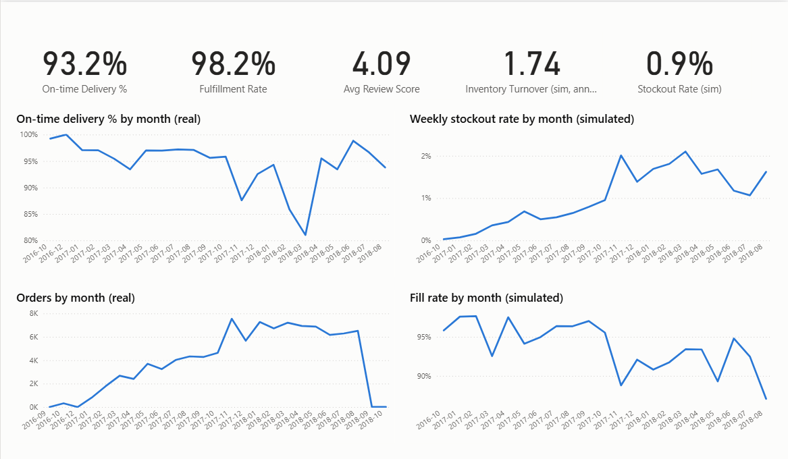
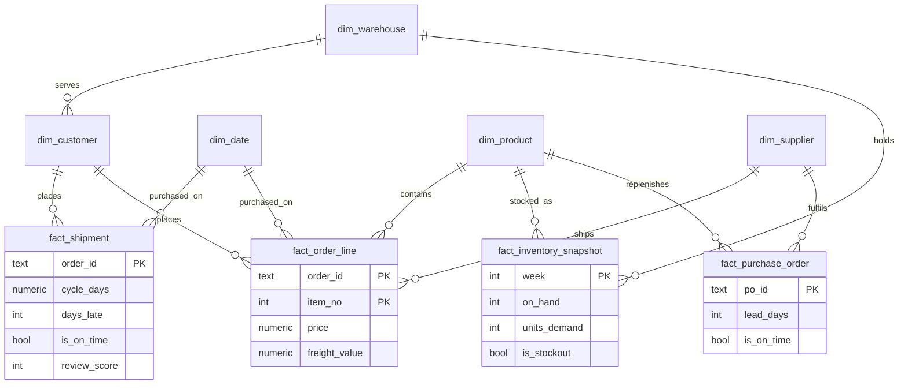
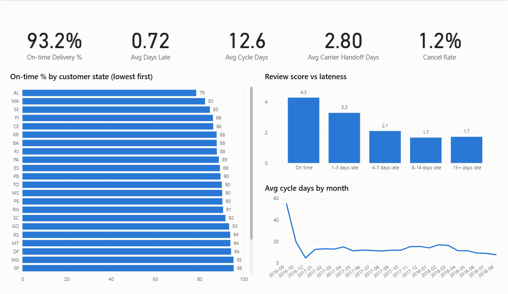
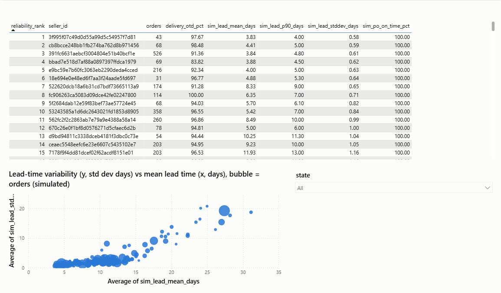
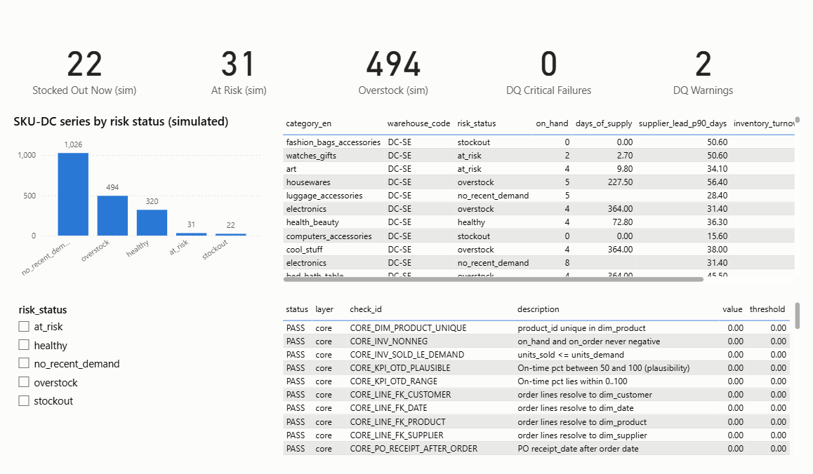

# Supply Chain and Inventory Performance Analysis

Where an online marketplace loses customer trust through late delivery, who and what is behind it, and what to change first.

## 1. Background and Overview

Olist is a Brazilian online marketplace. Small sellers list products, customers order, and the seller hands each parcel to a logistics partner. The customer is promised a delivery date at checkout and later leaves a review.

Operations leadership wants answers to four questions:

1. Are we delivering what we promise, and where do we fall short?
2. What does a late delivery cost us?
3. Which regions, sellers and handoffs drive the failures?
4. If we held stock in regional distribution centres, where would we run short and where would we hold too much?

**Scope.** 99,435 orders placed between September 2016 and October 2018, from 3,095 sellers, covering 32,951 products and customers in all 27 states. Delivery analysis uses the real orders. Olist publishes no inventory or purchase order data, so the inventory questions are answered with a clearly labelled simulation driven by real weekly sales (see Caveats).

## 2. Data Structure Overview

The model is a star schema with one row per order line, one row per order shipment, and weekly stock positions per product and distribution centre.

| Table | One row means | Source |
|---|---|---|
| fact_order_line | One unit on one order | Real |
| fact_shipment | One order, with delivery timing and review score | Real |
| fact_inventory_snapshot | End of week stock for one product at one distribution centre | Simulated |
| fact_purchase_order | One replenishment order to a supplier | Simulated |
| dim_customer, dim_supplier, dim_product, dim_date | Customers, sellers, products, calendar days | Real |
| dim_warehouse | One of four regional distribution centres | Simulated |

On time means the order was delivered on or before the promised date, compared by calendar day. Orders that were canceled, or delivered without a recorded date, are left out of the on time rate rather than counted as failures.

## 3. Executive Summary

Olist delivered 93.2% of measurable orders by the promised date, but the 6.8% that arrived late draw a one or two star review 62% of the time (9% for on time orders) and touch 986K BRL, or 7.3%, of the 13.6M BRL in order value. The cause is not an optimistic promise: the average promise is 23.7 days against 12.6 days actual delivery, and 87% of the extra time on late orders is spent with the carrier. The problem is concentrated. Five Northeast states hold 3.3% of orders but 7.7% of late ones, 78 sellers cause 21% of late deliveries from 11% of volume, and orders that wait more than 8 days for carrier pickup are five times more likely to be late, which gives operations an early warning signal. In the simulated inventory model, a quarter of stock value (116K of 458K BRL) is overstock, and raising reorder points on the 400 worst series lifts fill rate from 88.2% to 90.4% for 8.8% more inventory.

## 4. Insights Deep Dive

### 4.1 Late delivery is expensive

| Measure | On time orders | Late orders |
|---|---:|---:|
| Average review score | 4.29 | 2.27 |
| Share of reviews with 1 or 2 stars | 9% | 62% |
| Order value | 12.2M BRL | 986K BRL |

6,534 of 96,470 measurable orders were late. Review scores fall steadily with lateness: 4.3 on time, 3.3 for 1 to 3 days late, 2.1 for 4 to 7 days, and 1.7 beyond 8 days. A late order is the single clearest driver of a poor review in this data. The 986K BRL on late orders is the revenue most exposed to a lost repeat customer.

### 4.2 The delay sits with the carrier, not the promise

| Days | On time orders | Late orders |
|---|---:|---:|
| Purchase to carrier pickup (seller side) | 3.0 | 6.1 |
| Carrier pickup to delivery (carrier side) | 8.0 | 27.9 |
| Delivery promised at purchase | 23.8 | 22.6 |

Late orders were promised about the same window as on time ones, so the date is not the problem. Of the 23 extra days a late order takes, 87% is carrier transit and 13% is slow handoff by the seller. Across all orders the promise is already about twice the actual delivery time, so widening estimates would hide the problem rather than fix it.

On time performance is also unstable. November 2017 fell to 87.6% in the busiest month in the data (7,544 orders). March 2018 was the worst month at 81.0% on ordinary volume (7,211 orders), so peak load alone does not explain the dips.

### 4.3 A slow handoff predicts a late delivery

| Time from purchase to carrier pickup | Orders | Late rate | Average review |
|---|---:|---:|---:|
| Up to 3 days | 59,397 | 4.7% | 4.25 |
| 3 to 5 days | 19,999 | 6.7% | 4.13 |
| 5 to 8 days | 11,043 | 9.2% | 4.02 |
| More than 8 days | 5,894 | 23.3% | 3.53 |

An order that waits more than 8 days for pickup is five times more likely to arrive late than one picked up within 3 days. The signal is available while the parcel is still with the seller, long before the customer notices.

### 4.4 Five states and a small group of sellers carry a disproportionate share

| State | Orders | On time | Late orders | 95th percentile delivery |
|---|---:|---:|---:|---:|
| Alagoas (AL) | 397 | 78.6% | 85 | 46 days |
| Maranhao (MA) | 717 | 82.6% | 125 | 41 days |
| Sergipe (SE) | 335 | 84.8% | 51 | 43 days |
| Piaui (PI) | 476 | 86.1% | 66 | 38 days |
| Ceara (CE) | 1,279 | 86.2% | 176 | 45 days |

These states are 3.3% of orders and 7.7% of late deliveries. Bringing them to the national rate would remove about 286 late orders. Their long 95th percentile times point to long haul carrier legs.

Among the 425 sellers with at least 50 orders, 78 run a late rate above 10%. They ship 11% of orders and cause 21% of late deliveries. The weakest seller with meaningful volume delivers 69.9% on time.

### 4.5 Inventory risk (simulated)

Real weekly sales were replayed through a regional stocking model with four distribution centres, a weekly reorder policy, and supplier lead times that vary by supplier. Fifteen percent of suppliers were set up as unreliable, and the model plans with the lead time the supplier quotes.

| Position across 1,893 product and region combinations | Count |
|---|---:|
| Stocked out now | 22 |
| At risk (days of supply below the supplier's 90th percentile lead time) | 31 |
| Overstock (more than 120 days of supply) | 494 |
| No sales in the last 13 weeks | 1,026 |

Overstock holds 116K of 458K BRL of inventory at cost, about 25%. Unreliable suppliers deliver on time 24% of the time against 84% for reliable ones, which is what drives stockouts when the plan assumes the quoted lead time. Demand is a long tail: most product and region pairs sell only occasionally.

## 5. Recommendations

| # | Action | Owner | Evidence | Expected effect |
|---|---|---|---|---|
| 1 | Alert on any order with no carrier scan by day 5, escalate to the seller, and offer expedited shipping or proactive contact at day 8 | Operations | 8 day pickup delay means 23.3% late rate vs 4.7% | If the late rate halved for the 5,894 affected orders, about 686 fewer late deliveries (11% of all late orders). Illustrative, to be tested |
| 2 | Set carrier service levels on the 95th percentile and negotiate them by name for AL, MA, SE, PI and CE | Carrier management | 87% of extra time is carrier transit; 38 to 46 day tails | About 286 fewer late orders if the five states reach the national rate |
| 3 | Put the 78 sellers above a 10% late rate on a corrective plan with a 90% monthly target | Seller management | 11% of volume, 21% of late orders | Bringing them to the national rate would remove about 660 late orders (330 if half the gap closes). Estimate |
| 4 | Do not widen delivery estimates | Product and pricing | Promise is already 23.7 days against 12.6 actual | Avoids hiding the problem and a weaker checkout offer |
| 5 | Plan safety stock on the 90th percentile supplier lead time, and dual source products that depend on unreliable suppliers | Supply planning | 24% against 84% on time purchase orders (simulated) | Fill rate 88.2% to 90.4% on the 400 worst series for 8.8% more inventory (simulated) |
| 6 | Release overstock before placing new orders, and review slow movers for central stocking | Supply planning | 25% of inventory value is overstock (simulated) | Working capital release, size depends on real stock data |

Full detail with the underlying tables is in [docs/recommendations.md](docs/recommendations.md).

## 6. Caveats and Assumptions

- **Age and place.** The orders are from 2016 to 2018 and from one Brazilian marketplace. The method transfers, the exact numbers do not.
- **Simulated inventory.** There is no inventory, warehouse or purchase order data in the source. Stock levels, orders, lead times and the four distribution centres are generated with a fixed random seed. Demand is real, everything else is an assumption listed in [docs/assumptions.md](docs/assumptions.md). Treat sections 4.5 and recommendations 5 and 6 as a demonstration of the method.
- **Review score and lateness.** The link is strong but it is an association. Late orders may also differ in other ways.
- **Scenario estimates.** The 686, 286 and 660 late order reductions rest on stated assumptions (a halving of the late rate, reaching the national rate). They overlap, because the same late order can sit in a weak state, with a weak seller and behind a slow pickup, so do not add them together. They are targets to test, not results.
- **Data quality.** Six orders were rejected for a delivery date on a canceled order, 551 duplicate reviews were set aside, and 8 delivered orders had no delivery date. Rejected rows are kept in a quarantine table with a reason, and row counts reconcile exactly. 23 orders show carrier pickup after delivery and were kept but flagged.
- **Costs.** There are no shipping cost or margin figures, so impact is expressed in orders, reviews and order value, not profit.
- **Unmeasurable orders.** 2,965 orders could not be judged on time (canceled, in transit, or missing a date) and are excluded from on time rates.
- **Edge months.** September to October 2016 and September to October 2018 contain very few orders, so those months look unusual on charts.

## 7. How it was built

The numbers above come from a tested, scheduled pipeline, so every figure can be reproduced. A short summary:

- **PostgreSQL** holds five layers: raw, cleaned staging, a star schema, KPI views, and data quality results.
- **SQL** does the cleaning and modelling. **Python** loads the data and runs the simulation.
- **54 data quality checks** run after each layer. A critical failure stops the run.
- **Prefect** refreshes everything daily at 06:00. **72 automated tests** run in GitHub Actions on a small synthetic sample.
- **Power BI** reads the KPI views. Open `powerbi/SupplyChain.pbip`.

Setup, architecture and the data dictionary are in [docs/technical.md](docs/technical.md).
