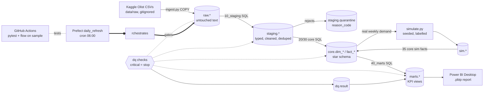

# Architecture

## Run order (flow `daily_refresh`)

1. `ingest_raw` – load the nine CSVs into `raw.*` as text (row counts logged to `dq.run_log`).
2. `10_staging` – cast types, clean, dedupe; rejects go to `staging.quarantine`.
3. **DQ gate: raw + staging** (critical failure stops the run).
4. `20_core_dims`, `30_core_facts` – star schema from staging.
5. `simulate` – seeded inventory/PO simulation driven by real weekly sales (needs the core order facts).
6. `35_core_sim_facts` – simulated facts with FKs into the dimensions.
7. **DQ gate: core.**
8. `40_marts` – KPI views.
9. **DQ gate: marts.**

Every layer is dropped and rebuilt, so any run can be repeated safely. If a gate fails, downstream layers
from the previous successful run stay in place.

## Schemas

| Schema | Purpose |
|---|---|
| `raw` | Source CSVs as delivered, all `TEXT` |
| `staging` | Typed/clean tables + `quarantine` |
| `core` | Dimensions and facts (surrogate integer keys, enforced FKs) |
| `sim` | Simulator outputs and parameters (**synthetic**) |
| `marts` | Views Power BI connects to |
| `dq` | Check definitions, results, step row-count log |

## Design decisions

- **Prefect over Airflow:** one lightweight container vs ~4 GB of services; same scheduled-DAG story.
- **SQL does the modelling, Python does I/O and simulation:** transformations are plain, reviewable SQL files, run in filename order.
- **Rejects are data:** nothing is silently dropped; the reconciliation check `raw = staged + quarantined` is critical.
- **Free-tier BI:** Power BI Service refresh needs Pro, so "scheduled refresh" means Prefect refreshes Postgres; the Desktop report is refreshed manually (see `docs/powerbi.md`).
